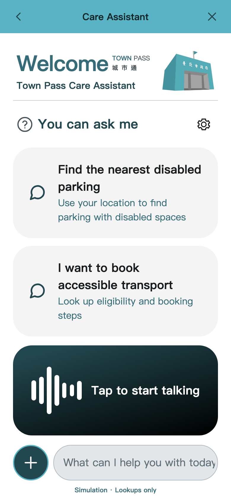
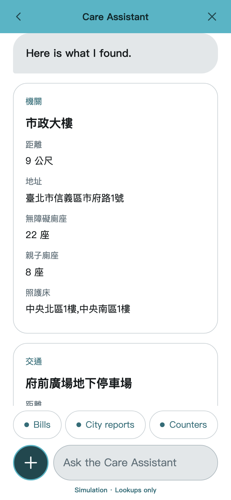
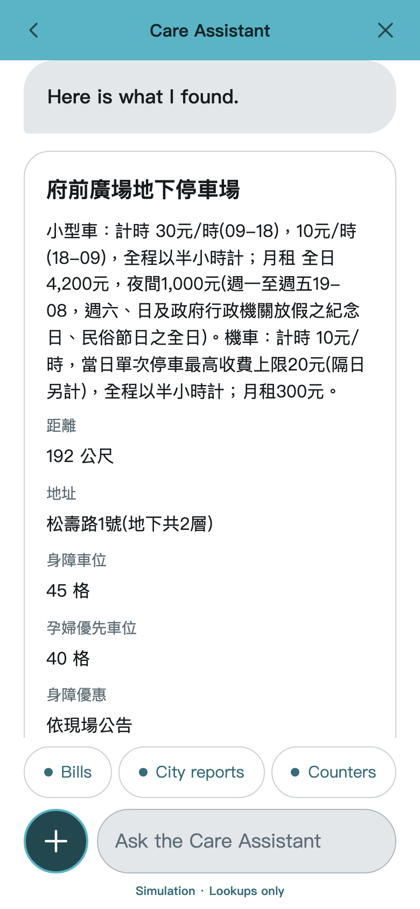
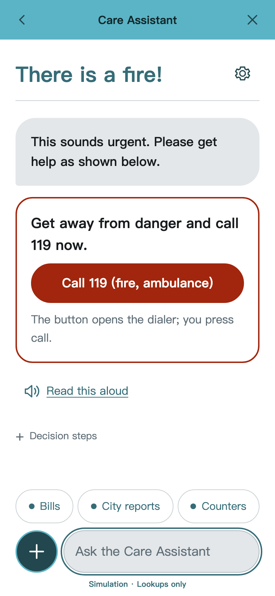
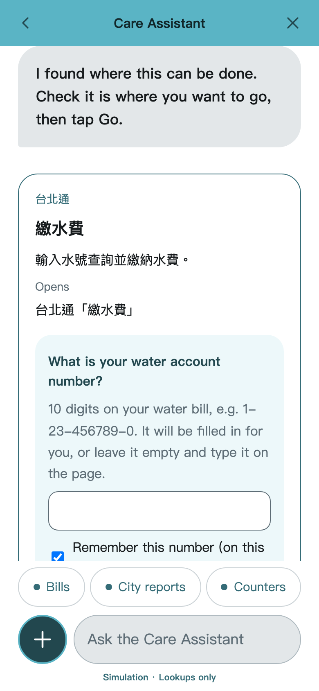
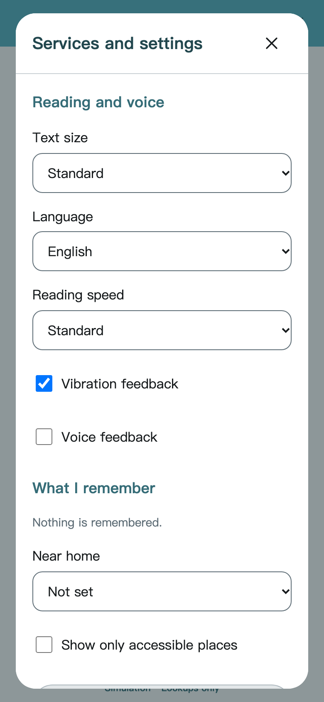
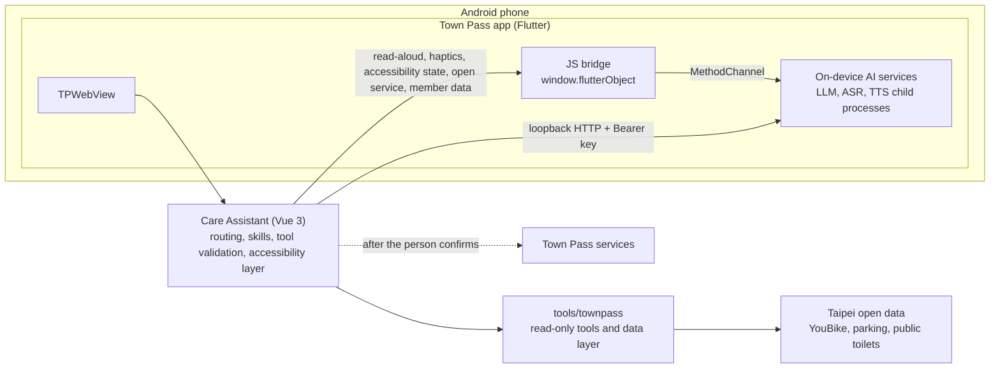

<div align="center">

# 用得了 · Town Pass Care Assistant

Find accessible facilities and get to Taipei city services with what the app already knows, by typing one sentence or tapping a suggestion inside the Town Pass app.<br>
For everyone who finds city services "用不了" (*"I can't use it"*), so they can say "用得了" (*"I can use it"*).

[](https://github.com/Twcat0503/2026_taipei_codefest/actions/workflows/ci.yml)
[](LICENSE)


[繁體中文](README.md) · **English**

</div>

## About

For people with disabilities, older adults, pregnant people, people with low vision and carers, the problem is rarely that a service does not exist. It is that they cannot use it: too many entry points, long forms, small text, and screens that have to be read carefully.

The **Care Assistant** lives inside the Town Pass app (Taipei's city app). People describe what they need in one sentence or tap a suggestion. The assistant looks up Taipei open data to find the nearest accessible toilets or parking with disabled spaces. When something needs to be done, it opens the right Town Pass service with the details it already knows (water account number, phone, email) filled in, asks the person to confirm before leaving, and never submits anything on their behalf. The language model runs on the phone, so conversations are not sent to a cloud model.

## Screenshots

| Home | Accessible toilets nearby | Nearest disabled parking |
| :---: | :---: | :---: |
|  |  |  |
| **Emergency help** | **Water bill with the account number filled in** | **Reading and voice settings** |
|  |  |  |

> Screenshots come from the browser's rule simulation mode (labelled "Simulation" at the bottom) with real open data. Inside the app the on-device model is used instead. Place names and data values stay in Chinese because the official datasets are in Chinese.

## Features

- **Accessibility first**: built to WCAG 2.1 AA. Fixes TalkBack not being able to swipe into WebView content; text follows the system font size and reflows at 200% without horizontal scrolling; the system bold text, high contrast and reduce motion settings are mirrored into the page.
- **Multi-sensory feedback**: haptics when an answer arrives, a lookup fails, an emergency card appears or a choice is tapped. With voice feedback on (and no screen reader running), answers are read aloud automatically. Read-aloud uses the system voice, or the optional on-device BlueMagpie natural voice.
- **Find places**: accessible toilets, parking with disabled or pregnancy priority spaces, and live YouBike availability, near the current location or in a chosen district; every lookup shows its data source and time.
- **Get things done**: Town Pass services such as bill payment, city reports, police reports and counter queue numbers. Leaving the assistant always asks for confirmation; known fields are filled in, and a city report is drafted from the person's own words as an editable draft that never adds details they did not say.
- **Emergency help**: emergencies skip the model and show call buttons for 119, 110, 113 and 1925 straight away.
- **On-device AI**: the LFM3-VL-2B multimodal language model runs on Android as a native child process, with optional whisper.cpp speech recognition and BlueMagpie speech synthesis. All three listen on loopback only, and no model ships with the app.
- **Privacy**: location is only used to compute distances and never sent to the model; national ID numbers are read from the member profile each time, shown masked, and never stored.

## Architecture



| Part | What it does | Where |
| --- | --- | --- |
| App | Town Pass Flutter app, `TPWebView`, JS bridge (read-aloud, haptics, accessibility state, form prefill), TalkBack and system font size fixes | `lib/`, `android/` |
| Care Assistant | Vue 3 web app: routing and skills, tap-to-answer choices, city report drafts, emergency calls, accessibility layer | `frontend/agent-mvp/` |
| Tools | Wraps Town Pass services and open data as read-only tools, with timeouts, caching and validation in the data layer | `tools/townpass/` |
| On-device AI | Build and model tooling for LFM3-VL-2B (llama.cpp), whisper.cpp ASR and BlueMagpie TTS | `tools/llm-android/`, `tools/asr-android/`, `tools/tts-android/` |
| Service template | Snapshot of TownPass-Services, kept for reference | `frontend/` |

## Tech stack

| Layer | Technology |
| --- | --- |
| App | Flutter 3.47.6 (FVM), GetX, flutter_inappwebview, flutter_tts |
| Web | Vue 3, Vite, TypeScript |
| Tools | TypeScript read-only tools (direct function calls), zod |
| On-device AI | llama.cpp (LFM3-VL-2B), whisper.cpp, BlueMagpie-TTS, all as Android native child processes |
| Quality | ESLint, Prettier, Vitest, Playwright with axe (WCAG 2.1 AA scans), `dart format`, `flutter analyze`, `flutter test`, GitHub Actions |

## Getting started

### Browser only (no Flutter or model needed)

Requires [mise](https://mise.jdx.dev/) to install the Node and pnpm versions pinned in `mise.toml`.

```sh
cd tools/townpass
mise install && pnpm install --frozen-lockfile
cd ../../frontend/agent-mvp
mise install && pnpm install --frozen-lockfile
pnpm dev
```

Open <http://127.0.0.1:5173>. Without a model endpoint the assistant runs in rule simulation, not AI; the tools and open data are real.

### On an Android phone

Requires [FVM](https://fvm.app/) (the Flutter version is pinned in `.fvmrc`) and an Android phone or emulator.

```sh
fvm install
fvm flutter pub get
fvm dart run build_runner build
adb reverse tcp:5173 tcp:5173   # lets the phone reach pnpm dev on your computer
fvm flutter run -d <device-id>
```

The Care Assistant entry on the app's home screen opens the assistant. The on-device models are built and installed separately; see [`tools/llm-android`](tools/llm-android/README.md), [`tools/asr-android`](tools/asr-android/README.md) and [`tools/tts-android`](tools/tts-android/README.md) (in Chinese).

## Testing

| Scope | Commands | Status |
| --- | --- | --- |
| Flutter | `fvm flutter analyze`, `fvm flutter test` | no issues; 190 tests pass |
| Care Assistant | `pnpm lint`, `pnpm test`, `pnpm build`, `pnpm test:e2e` | 425 unit tests and 35 end-to-end tests (with axe scans) pass |
| Tools | `pnpm typecheck`, `pnpm test` (in `tools/townpass`) | 34 tests pass |

CI only checks the parts affected by a change; see [CONTRIBUTING.md](CONTRIBUTING.md) (in Chinese).

## Project structure

```text
lib/                  Flutter app (Town Pass snapshot, assistant entry, bridges)
android/              Android native code (on-device AI services, TalkBack fix)
frontend/agent-mvp/   Care Assistant web app
tools/townpass/       Read-only tools and data layer
tools/llm-android/    Build and install tooling for on-device LFM3
tools/asr-android/    Build and model conversion tooling for whisper.cpp ASR
tools/tts-android/    Build and model tooling for BlueMagpie TTS
frontend/             TownPass-Services template (reference)
docs/screenshots/     README screenshots
```

## Data sources

By default the app only answers from the real data and official services below, never from mock data.

| Dataset | Provider | Link | Used for |
| --- | --- | --- | --- |
| YouBike 2.0 Taipei real-time availability | Department of Transportation, Taipei City Government | <https://data.taipei/dataset/detail?id=c6bc8aed-557d-41d5-bfb1-8da24f78f2fb> | Bikes and docks available at nearby stations (updated every minute) |
| Taipei parking lots | Parking Management and Development Office, Department of Transportation | <https://data.taipei/dataset/detail?id=d5c0656b-5250-4179-a491-c94daa56ef2c> | Location, fees, disabled and pregnancy priority spaces (live free-space data is discontinued and not used) |
| Taipei public toilets | Department of Environmental Protection, Taipei City Government | <https://data.taipei/dataset/detail?id=ca205b54-a06f-4d84-894c-d6ab5079ce79> | Accessible stalls, family stalls and changing beds (bundled official dated snapshot) |

Open data is attributed under the [Open Government Data License, version 1.0](https://data.gov.tw/license); every lookup shows the provider, dataset and data time.

Service destinations (opened only after the person confirms; the assistant never submits forms): Town Pass in-app services come first (city reports, bill payment, counter queue numbers, library, subscriptions, police reports, offers; these pages show TownPass-Services template data and say so on screen). Official websites are used only when Town Pass has no equivalent: [Taipei Service](https://service.taipei/) (categories for people with disabilities, pregnant people and older adults) and the 1999 citizen hotline.

The [TownPass-Services](https://github.com/taipei-doit/TownPass-Services) `public/mock/*.json` demo data is only used with `VITE_TOOL_SOURCE=townpass-demo` during development.

## Contributing

Issues and pull requests are welcome. The development flow, commit and PR rules and accessibility self-checks are in [CONTRIBUTING.md](CONTRIBUTING.md), the code of conduct in [CODE_OF_CONDUCT.md](CODE_OF_CONDUCT.md), guidance for AI coding agents in [AGENTS.md](AGENTS.md), and open tasks in [TODO.md](TODO.md) (these documents are in Chinese).

## License

This project is licensed under the [GNU Affero General Public License v3.0](LICENSE) (AGPL-3.0).

- It starts from a snapshot of [Town Pass](https://github.com/taipei-doit/TownPass) (GPL-3.0), open-sourced by the Department of Information Technology, Taipei City Government; the GPL-3.0 parts are combined into the AGPL-3.0 work under GPLv3 section 13.
- The PingFang TC fonts in `fonts/` came with the upstream snapshot. They are Apple's proprietary fonts, are not covered by this project's license, and will be replaced with an open font.
- The models (LFM3, Taiwan-Tongues-ASR, BlueMagpie-TTS) are not included in this repository or the app; each is used under its own license.
- See [THIRD_PARTY_NOTICES.md](THIRD_PARTY_NOTICES.md) for third-party components, models and open data.

## Acknowledgements

- The **Department of Information Technology, Taipei City Government**, for open-sourcing [Town Pass](https://github.com/taipei-doit/TownPass) and [TownPass-Services](https://github.com/taipei-doit/TownPass-Services) and providing the [Town Pass developer guide](https://tpe-guideline.web.app) and design resources.
- **Open data providers**: the Department of Transportation, its Parking Management and Development Office, the Department of Environmental Protection, and the [Taipei Open Data platform](https://data.taipei).
- **Open models and projects**: [Liquid AI](https://huggingface.co/LiquidAI) (LFM3), [OpenFormosa](https://huggingface.co/OpenFormosa) (BlueMagpie-TTS), [adi-gov-tw](https://huggingface.co/adi-gov-tw) (Taiwan-Tongues-ASR-CE), [ggml-org](https://github.com/ggml-org) (llama.cpp, whisper.cpp, ggml), [codec.cpp](https://github.com/mybigday/codec.cpp), and the Flutter, Vue, Vite, Playwright and axe-core communities.

### Contributors

[Twcat0503](https://github.com/Twcat0503) · [Sean-Hawks](https://github.com/Sean-Hawks) · [alaner652](https://github.com/alaner652) · [him6794](https://github.com/him6794) · [itousouta15](https://github.com/itousouta15) (full list on [Contributors](https://github.com/Twcat0503/2026_taipei_codefest/graphs/contributors))
