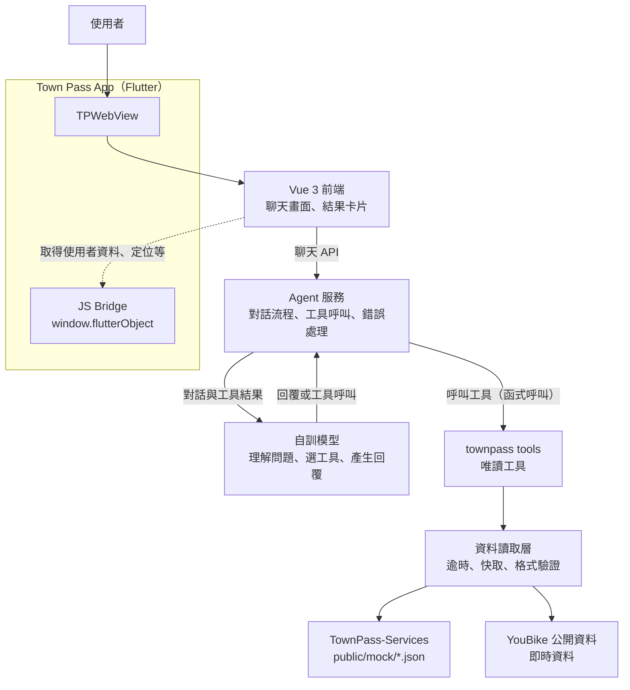

# 用得了

在城市通（Town Pass）裡用對話使用台北通服務：自訓模型理解使用者的問題並選擇工具，agent 把需求拆成步驟、逐步呼叫包裝好的台北通服務工具，最後把結果整理成卡片回覆。2026 臺北秋季程式設計節作品，回應競賽主題「用不了」。

- 正式站：待補（Cloudflare Pages 網址）
- 授權：[AGPL-3.0](LICENSE)

## 架構



| 區塊 | 內容 | 狀態 | 位置 |
| --- | --- | --- | --- |
| App | Town Pass Flutter app：`TPWebView`、JS bridge（含 `tts`、`share`）、系統字級同步 | 可用 | `lib/` |
| 前端 | Vue 3 聊天畫面與結果卡片，以 TownPass-Services 為範本 | 開發中 | `frontend/`（常駐 branch `frontend`） |
| Agent | 路由、圖書／服務代理、工具驗證、確認與示範回執 | MVP 已可操作；正式模型待接 | `frontend/agent-mvp/` |
| 模型 | 自訓模型（LFM3 1.7B、int4 量化）：理解問題、選工具、產生回覆 | 規劃中 | `model/`（常駐 branch `model`） |
| 工具 | `townpass` tools：把台北通服務包裝成唯讀工具，經資料讀取層存取資料 | 16 支工具，agent 已接上 | `tools/townpass/`（常駐 branch `tools`） |

## 已可操作的 Agent MVP

[獨立 MVP](frontend/agent-mvp/README.md) 已整合 App 首頁與服務頁入口。它實作受限單次任務流程，使用模擬服務資料；Qwen3 1.7B 僅為聯調模型，正式模型由隊友提供，工具由 `tools/townpass/` 提供。上方架構圖是團隊目標架構，MVP 的實際流程、UI／UX 修改入口與驗收方式見 [交接文件](frontend/agent-mvp/docs/ui-ux-handoff.md)。

```sh
cd frontend/agent-mvp
mise install
pnpm install --frozen-lockfile
pnpm dev
```

新 checkout 預設為規則模擬，不需模型或 Flutter。原有 `frontend/` 服務範本保留，兩個專案分別安裝相依與執行測試。MVP 預設使用 5173；同時啟動範本時請為範本指定其他 port。

## 技術棧

| 層 | 技術 |
| --- | --- |
| App | Flutter 3.47.6（FVM）、GetX、flutter_inappwebview、flutter_tts、share_plus |
| 前端 | Vue 3、Vite、TypeScript、Tailwind CSS、Pinia、vue-router |
| 工具 | TypeScript、zod，由 agent 直接呼叫 |
| 模型 | LFM3 1.7B（int4） |
| 品質 | ESLint、Prettier、Vitest、`dart format`、`flutter analyze`，由 GitHub Actions CI 把關 |
| 部署 | Cloudflare Pages（前端）、Android APK（app） |

## 快速開始

```sh
# 前端（只要瀏覽器就能開發；在 frontend branch 上）
cd frontend
mise install && pnpm install
pnpm dev

# App（以 Android 為準）
fvm install
fvm flutter pub get
fvm dart run build_runner build
fvm flutter run -d <device-id>
```

完整指令、開發規範與協作流程見 [AGENTS.md](AGENTS.md) 與 [CONTRIBUTING.md](CONTRIBUTING.md)，待辦事項見 [TODO.md](TODO.md)。

## 資料來源

| 資料 | 提供單位 | 連結 | 用途 |
| --- | --- | --- | --- |
| TownPass-Services `public/mock/*.json` | taipei-doit | <https://github.com/taipei-doit/TownPass-Services> | 台北通服務的示範資料與靜態快照 |
| YouBike 公開資料 | 待補 | 待補 | 即時資料 |

開放資料依《政府資料開放授權條款－第1版》顯名，完整清單同步列在前端的 `/about`。

## 授權與致謝

- 本作品以 [AGPL-3.0](LICENSE) 授權。
- 本 repo 以臺北市政府開源的 [Town Pass](https://github.com/taipei-doit/TownPass)（GPL-3.0）快照為基礎開發；Town Pass 的設計與開發文件見 <https://tpe-guideline.web.app>。
- `frontend/` 以 [TownPass-Services](https://github.com/taipei-doit/TownPass-Services) 為範本。該 repo 未附授權條款，使用方式依城市通開發文件的指示：「Fork 專案程式庫，然後將專案 clone 到您的電腦」。
