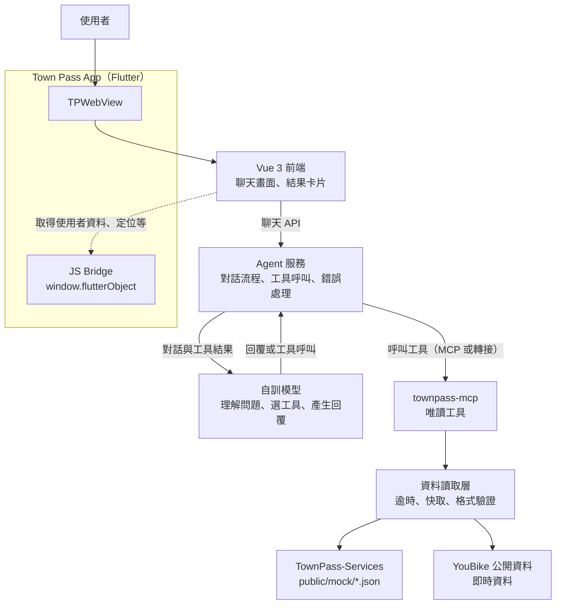

# 用得了

在城市通（Town Pass）裡用對話使用台北通服務：自訓模型理解使用者的問題並選擇工具，agent 把需求拆成步驟、逐步呼叫包裝好的台北通服務工具，最後把結果整理成卡片回覆。2026 臺北秋季程式設計節作品，回應競賽主題「用不了」。

- 正式站：待補（Cloudflare Pages 網址）
- 授權：[AGPL-3.0](LICENSE)

## 架構



| 區塊 | 內容 | 狀態 | 位置 |
| --- | --- | --- | --- |
| App | Town Pass Flutter app：`TPWebView`、JS bridge（`tts` 朗讀生命週期、`haptic`、`a11y_state`、`share`、表單帶入）、系統字級同步、TalkBack 可進入 WebView | 可用 | `lib/`、`android/` |
| 前端範本 | TownPass-Services 服務範本（保留作參考，主要開發在 agent-mvp） | 保留 | `frontend/`（常駐 branch `frontend`） |
| Agent | 安心助手：Figma 版介面、路由與各 skill、補資料的選擇題、陳情草稿與表單帶入、緊急撥號、震動與語音回饋、朗讀 | 已接手機模型與唯讀工具；個人帳務未接 | `frontend/agent-mvp/` |
| 模型 | LFM3 1.7B 手機本機推論（native 子行程） | 已整合 | `tools/llm-android/`（常駐 branch `model`） |
| 語音 | 手機本機 ASR（whisper.cpp）與選用的 BlueMagpie 自然語音；模型需另行安裝 | 原生服務可用；ASR 尚無前端入口，自然語音在設定開啟 | `tools/asr-android/`、`tools/tts-android/` |
| 工具 | `tools/townpass`：把台北通服務與開放資料包裝成唯讀工具，經資料讀取層存取資料 | 可用 | `tools/townpass/`（常駐 branch `tools`） |

## 已可操作的 Agent MVP

[獨立 MVP](frontend/agent-mvp/README.md) 已整合 App 首頁與服務頁入口，以及手機 LFM3、Figma 版聊天介面與隊友的唯讀工具。預設只用真實資料（YouBike 即時資料、停車場與公廁開放資料、台北通站內服務入口）；示範帳單只在 `VITE_TOOL_SOURCE=townpass-demo` 時出現。沒有正式個人帳務或 MCP transport。上方架構圖是團隊目標架構，MVP 的實際流程、UI／UX 修改入口與驗收方式見 [交接文件](frontend/agent-mvp/docs/ui-ux-handoff.md)。

```sh
cd frontend/agent-mvp
mise install
pnpm install --frozen-lockfile
pnpm dev
```

新 checkout 預設為規則模擬，不需模型或 Flutter。原有 `frontend/` 服務範本保留，兩個專案分別安裝相依與執行測試。MVP 預設使用 5173；同時啟動範本時請為範本指定其他 port。

## 技術棧

| 層 | 技術 |
| --- | --- |
| App | Flutter 3.47.6（FVM）、GetX、flutter_inappwebview、flutter_tts、share_plus |
| 前端 | Vue 3、Vite、TypeScript、Tailwind CSS、Pinia、vue-router |
| 工具 | TypeScript 唯讀工具（直接函式呼叫；MCP transport 尚未接） |
| 模型與語音 | LFM3 1.7B、whisper.cpp（ASR）、BlueMagpie-TTS，皆在 Android 上以 native 子行程本機執行 |
| 品質 | ESLint、Prettier、Vitest、Playwright（含 axe 無障礙掃描）、`dart format`、`flutter analyze`、`flutter test`，由 GitHub Actions CI 把關 |
| 部署 | Cloudflare Pages（前端）、Android APK（app） |

## 快速開始

```sh
# 前端（只要瀏覽器就能開發；在 frontend branch 上）
cd frontend
mise install && pnpm install
pnpm dev

# App（以 Android 為準）
fvm install
fvm flutter pub get
fvm dart run build_runner build
fvm flutter run -d <device-id>
```

完整指令、開發規範與協作流程見 [AGENTS.md](AGENTS.md) 與 [CONTRIBUTING.md](CONTRIBUTING.md)，待辦事項見 [TODO.md](TODO.md)。

## 資料來源

App 預設只用下列真實資料與官方服務，不拿模擬資料回答使用者。

| 資料 | 提供機關 | 連結 | 用途 |
| --- | --- | --- | --- |
| YouBike2.0臺北市公共自行車即時資訊 | 臺北市政府交通局 | <https://data.taipei/dataset/detail?id=c6bc8aed-557d-41d5-bfb1-8da24f78f2fb> | 附近站點的即時可借、可還數（每分鐘更新） |
| 臺北市停車場資訊 | 臺北市政府交通局停車管理工程處 | <https://data.taipei/dataset/detail?id=d5c0656b-5250-4179-a491-c94daa56ef2c> | 停車場位置、費率、身障與孕婦車位數（剩餘車位已停更，不使用） |
| 臺北市公廁點位資訊 | 臺北市政府環境保護局 | <https://data.taipei/dataset/detail?id=ca205b54-a06f-4d84-894c-d6ab5079ce79> | 無障礙廁座、親子廁座、照護床（打包官方日期快照） |

開放資料依《政府資料開放授權條款－第1版》（<https://data.gov.tw/license>）顯名，畫面上每次查詢都標示提供機關、資料集與資料時間，完整清單同步列在前端的 `/about`。

服務入口（使用者確認後才前往，助手不代為送出）：優先帶到台北通站內的微服務（有話要說、繳費、臨櫃叫號、圖書借閱、訂閱、報案、優惠；頁面為 TownPass-Services 範本示範資料，畫面上會標示）；台北通沒有的才用官方網站：[台北服務通](https://service.taipei/)（身障者、孕婦、長者分類）、1999 市民當家熱線。

開發用的 [TownPass-Services](https://github.com/taipei-doit/TownPass-Services) `public/mock/*.json` 示範資料只在 `VITE_TOOL_SOURCE=townpass-demo` 時使用。

## 授權與致謝

- 本作品以 [AGPL-3.0](LICENSE) 授權。
- 本 repo 以臺北市政府開源的 [Town Pass](https://github.com/taipei-doit/TownPass)（GPL-3.0）快照為基礎開發；Town Pass 的設計與開發文件見 <https://tpe-guideline.web.app>。
- `frontend/` 以 [TownPass-Services](https://github.com/taipei-doit/TownPass-Services) 為範本。該 repo 未附授權條款，使用方式依城市通開發文件的指示：「Fork 專案程式庫，然後將專案 clone 到您的電腦」。
