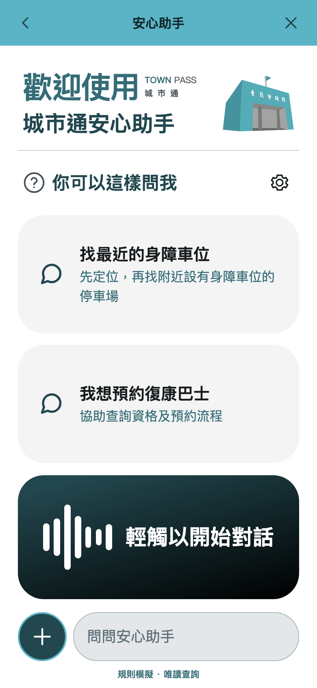
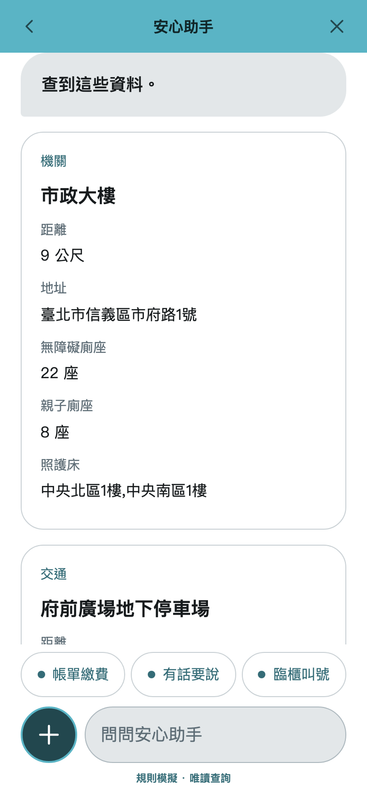
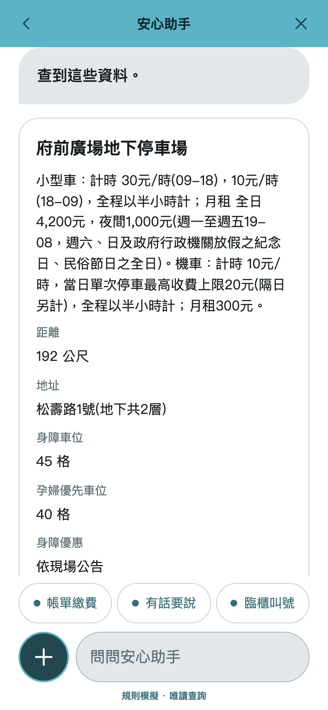
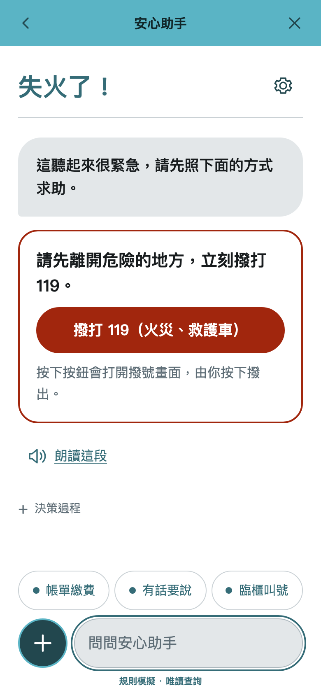
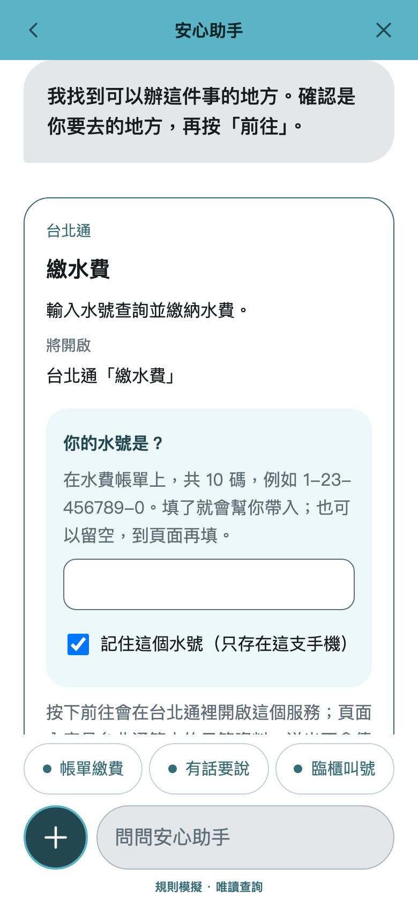
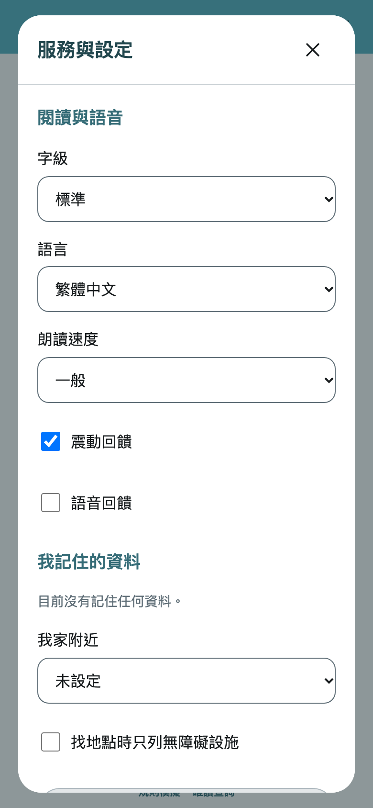
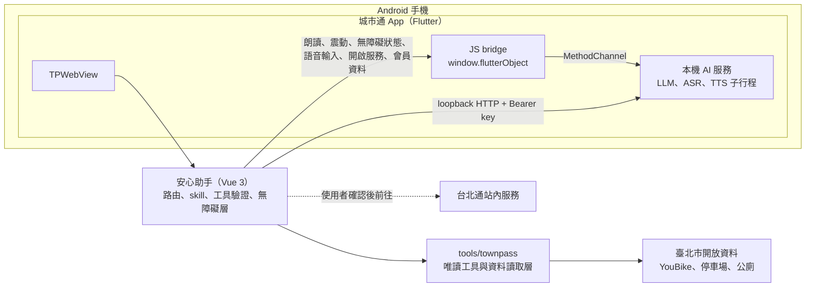

<div align="center">

# 用得了：城市通安心助手

在城市通（Town Pass）裡，打一句話或點一下，就能找到無障礙設施，帶著已知的資料前往台北通服務。<br>
讓覺得城市服務「用不了」的人，也能用得了。

[](https://github.com/Twcat0503/2026_taipei_codefest/actions/workflows/ci.yml)
[](LICENSE)


**繁體中文** · [English](README.en.md)

</div>

## 簡介

身心障礙者、長者、孕婦、視力不便者與照顧者常遇到的不是「沒有服務」，而是「用不了」：入口太多、表單太長、字太小、要看清楚畫面才能操作。

**安心助手**是嵌在城市通 App 裡的助理。使用者用說的或打字描述需求，或點選建議，助手會查詢臺北市的開放資料、找出最近的無障礙廁所或身障車位；需要辦事時，帶著已知的資料（水號、手機、Email）開啟台北通站內服務，由使用者確認後才前往，不代為送出。語言模型在手機上本機執行，對話不送到雲端模型。

## 截圖

| 首頁 | 找附近的無障礙廁所 | 找最近的身障車位 |
| :---: | :---: | :---: |
|  |  |  |
| **緊急求助** | **繳水費時帶入水號** | **閱讀與語音設定** |
|  |  |  |

> 截圖為瀏覽器的規則模擬模式（畫面下方標示「規則模擬」），資料為真實的開放資料；App 內改用手機本機模型。

## 功能

- **搖一搖入口**：城市通首頁搖一搖，先震動一下再開啟安心助手，首頁開關可關閉並記住偏好；切到其他分頁、開啟其他頁面或退到背景時停止偵測，連續搖動不會重複開頁。原本的安心助手按鈕仍可直接使用。感測使用 [sensors_plus](https://pub.dev/packages/sensors_plus)（BSD-3-Clause，與 AGPL-3.0 相容），沿用平台的去重力加速度事件，不儲存或傳送感測資料。
- **無障礙優先**：以 WCAG 2.1 AA 為標準。修正 TalkBack 無法滑進 WebView 內容的問題；字級跟隨系統並可放大到 200% 而不需橫向捲動；系統的粗體、高對比與減少動態設定會同步到網頁。
- **多感官回饋**：回答完成、出錯、緊急狀況與點選選項時有震動；「語音回饋」打開時（且沒有開螢幕閱讀器），回答會自動朗讀。朗讀使用系統語音，也可選用手機本機的 BlueMagpie 自然語音。
- **語音輸入**：首頁的語音鍵與輸入框旁的麥克風。App 內用手機本機語音辨識，錄音只留在記憶體；純瀏覽器時改用瀏覽器內建的語音辨識。辨識出的文字先填入輸入框，由使用者確認後才送出。
- **找地點**：依目前位置（GPS）、行政區或常見地標，查無障礙廁所、身障與孕婦優先車位、YouBike 即時車輛；每次查詢都標示資料來源與時間。
- **帶你去辦事**：繳費、陳情、災情通報、報案、臨櫃叫號等台北通站內服務。前往前一律再確認一次；已知欄位自動帶入，帶不進去的欄位會列出來請使用者自己填；陳情與災情通報依使用者原話整理成可修改的草稿，不編造沒說過的內容。
- **緊急求助**：規則偵測到緊急狀況時不經模型，直接顯示 119、110、113、1925 的撥號按鈕；規則沒抓到的，路由另有「緊急」選項兜底。重新載入後按鈕仍在，朗讀也會說明撥號方式。
- **本機 AI**：在 Android 上以 native 子行程執行 LFM3-VL-2B 多模態語言模型，另有選用的 whisper.cpp 語音辨識（語音輸入用）與 BlueMagpie 語音合成；三者都只綁 loopback，模型不隨 App 發布。
- **隱私**：位置只用來計算距離、不送進模型；身分證字號每次從會員資料讀取、只遮罩顯示，不寫入儲存空間。

## 架構



| 區塊 | 內容 | 位置 |
| --- | --- | --- |
| App | Town Pass Flutter app、`TPWebView`、JS bridge（朗讀、震動、無障礙狀態、語音輸入、表單帶入）、TalkBack 與系統字級修正 | `lib/`、`android/` |
| 安心助手 | Vue 3 Web App：路由與各 skill、補資料的選擇題、陳情與災情通報草稿、緊急撥號、語音輸入、無障礙層 | `frontend/agent-mvp/` |
| 工具 | 把台北通服務與開放資料包裝成唯讀工具，經資料讀取層處理逾時、快取與格式驗證；另有開發中的共用服務工具庫，由主機上的模型把頁面或 API 文件逐步解析成工具 | `tools/townpass/` |
| 本機 AI | LFM3-VL-2B（llama.cpp）、whisper.cpp ASR、BlueMagpie TTS 的建置與模型工具 | `tools/llm-android/`、`tools/asr-android/`、`tools/tts-android/` |
| 服務範本 | TownPass-Services 快照（參考用），另加上 `/about` 資料來源頁與頁內字級切換 | `frontend/` |

## 技術棧

| 層 | 技術 |
| --- | --- |
| App | Flutter 3.47.6（FVM）、GetX、flutter_inappwebview、flutter_tts |
| Web | Vue 3、Vite、TypeScript |
| 工具 | TypeScript 唯讀工具（直接函式呼叫）、zod |
| 本機 AI | llama.cpp（LFM3-VL-2B）、whisper.cpp、BlueMagpie-TTS，皆為 Android native 子行程 |
| 品質 | ESLint、Prettier、Vitest、Playwright 與 axe（WCAG 2.1 AA 掃描）、`dart format`、`flutter analyze`、`flutter test`、GitHub Actions |

## 快速開始

### 只用瀏覽器（不需要 Flutter 或模型）

需要 [mise](https://mise.jdx.dev/)（安裝 `mise.toml` 釘選的 Node 與 pnpm）。

```sh
cd tools/townpass
mise install && pnpm install --frozen-lockfile
cd ../../frontend/agent-mvp
mise install && pnpm install --frozen-lockfile
pnpm dev
```

開啟 <http://127.0.0.1:5173>。沒有設定模型接點時是規則模擬，不是 AI；工具與開放資料是真的。

### 在 Android 手機上

需要 [FVM](https://fvm.app/)（Flutter 版本由 `.fvmrc` 釘選）與 Android 手機或模擬器。

```sh
fvm install
fvm flutter pub get
fvm dart run build_runner build
adb reverse tcp:5173 tcp:5173   # 讓手機連到電腦上的 pnpm dev
fvm flutter run -d <device-id>
```

App 首頁的「安心助手」入口會開啟助手。手機本機模型需要另外建置與安裝，步驟見 [`tools/llm-android`](tools/llm-android/README.md)、[`tools/asr-android`](tools/asr-android/README.md)、[`tools/tts-android`](tools/tts-android/README.md)。

## 測試

| 範圍 | 指令 | 現況 |
| --- | --- | --- |
| Flutter | `fvm flutter analyze`、`fvm flutter test` | 無 issue；204 個測試通過 |
| 安心助手 | `pnpm lint`、`pnpm test`、`pnpm build`、`pnpm test:e2e` | 541 個單元測試、47 個 e2e 測試（含 axe 掃描）通過 |
| 工具 | `pnpm typecheck`、`pnpm test`（`tools/townpass`） | 114 個測試通過 |

CI 會依改動的路徑只檢查受影響的部分，見 [CONTRIBUTING.md](CONTRIBUTING.md#pr-規範)。

## 專案結構

```text
lib/                  Flutter app（Town Pass 快照、安心助手入口、bridge）
android/              Android 原生碼（本機 AI 服務、TalkBack 修正）
frontend/agent-mvp/   安心助手 Web App
tools/townpass/       唯讀工具、資料讀取層與共用服務工具庫
tools/llm-android/    LFM3 本機推論的建置與安裝工具
tools/asr-android/    whisper.cpp 語音辨識的建置與模型轉換工具
tools/tts-android/    BlueMagpie 語音合成的建置與模型工具
frontend/             TownPass-Services 服務範本與 /about 資料來源頁
docs/screenshots/     README 截圖
```

## 資料來源

App 預設只用下列真實資料與官方服務，不拿模擬資料回答使用者。

| 資料 | 提供機關 | 連結 | 用途 |
| --- | --- | --- | --- |
| YouBike2.0臺北市公共自行車即時資訊 | 臺北市政府交通局 | <https://data.taipei/dataset/detail?id=c6bc8aed-557d-41d5-bfb1-8da24f78f2fb> | 附近站點的即時可借、可還數（每分鐘更新） |
| 臺北市停車場資訊 | 臺北市政府交通局停車管理工程處 | <https://data.taipei/dataset/detail?id=d5c0656b-5250-4179-a491-c94daa56ef2c> | 停車場位置、費率、身障與孕婦車位數（剩餘車位已停更，不使用） |
| 臺北市公廁點位資訊 | 臺北市政府環境保護局 | <https://data.taipei/dataset/detail?id=ca205b54-a06f-4d84-894c-d6ab5079ce79> | 無障礙廁座、親子廁座、照護床（打包官方日期快照） |
| 臺北市陳情系統類別資料 | 臺北市政府研究發展考核委員會 | <https://data.taipei/dataset/detail?id=cb423c17-88eb-4231-a725-f1b93247d1bf> | 陳情的主類別、次類別與受理機關 |
| 臺北市所轄面積暨行政區里鄰數量月報表 | 臺北市政府民政局 | <https://data.taipei/dataset/detail?id=d1bb140b-733b-43cc-91ca-685a984d022a> | 臺北市 12 個行政區的名稱 |

開放資料依[《政府資料開放授權條款－第1版》](https://data.gov.tw/license)顯名，畫面上每次查詢都標示提供機關、資料集與資料時間。

服務入口（使用者確認後才前往，助手不代為送出）：優先帶到台北通站內的微服務（有話要說、繳費、臨櫃叫號、圖書借閱、訂閱、報案、優惠；頁面為 TownPass-Services 範本示範資料，畫面上會標示）；台北通沒有的才用官方網站：[台北服務通](https://service.taipei/)（身障者、孕婦、長者分類）、1999 市民當家熱線。

開發用的 [TownPass-Services](https://github.com/taipei-doit/TownPass-Services) `public/mock/*.json` 示範資料只在 `VITE_TOOL_SOURCE=townpass-demo` 時使用。

## 參與貢獻

歡迎開 issue 或 PR。開發流程、Commit 與 PR 規範、設計自檢方式見 [CONTRIBUTING.md](CONTRIBUTING.md)，行為準則見 [CODE_OF_CONDUCT.md](CODE_OF_CONDUCT.md)；給 AI coding agent 的專案說明在 [AGENTS.md](AGENTS.md)，待辦事項在 [TODO.md](TODO.md)。

## 授權

本專案以 [GNU Affero General Public License v3.0](LICENSE)（AGPL-3.0）授權。

- 以臺北市政府資訊局開源的 [Town Pass](https://github.com/taipei-doit/TownPass)（GPL-3.0）快照為基礎；GPL-3.0 的部分依 GPLv3 第 13 條併入 AGPL-3.0 的成品。
- `fonts/` 的 PingFang TC 字型隨上游快照帶入，是 Apple 的專有字型，不在本專案的授權範圍內，之後會改用開源字型。
- 模型（LFM3、Taiwan-Tongues-ASR、BlueMagpie-TTS）不包含在本 repo 或 App 中，使用時依各自的授權。
- 第三方元件、模型與開放資料的完整授權整理見 [THIRD_PARTY_NOTICES.md](THIRD_PARTY_NOTICES.md)。

## 致謝

- **臺北市政府資訊局**開源 [Town Pass](https://github.com/taipei-doit/TownPass) 與 [TownPass-Services](https://github.com/taipei-doit/TownPass-Services)，並提供[城市通開發文件](https://tpe-guideline.web.app)與設計資源。
- **開放資料提供機關**：臺北市政府交通局、交通局停車管理工程處、環境保護局、研究發展考核委員會、民政局，以及[臺北市資料大平臺](https://data.taipei)。
- **開源模型與專案**：[Liquid AI](https://huggingface.co/LiquidAI)（LFM3）、[OpenFormosa](https://huggingface.co/OpenFormosa)（BlueMagpie-TTS）、[adi-gov-tw](https://huggingface.co/adi-gov-tw)（Taiwan-Tongues-ASR-CE）、[ggml-org](https://github.com/ggml-org)（llama.cpp、whisper.cpp、ggml）、[codec.cpp](https://github.com/mybigday/codec.cpp)，以及 Flutter、Vue、Vite、Playwright、axe-core 等社群。

### 貢獻者

[Twcat0503](https://github.com/Twcat0503) · [Sean-Hawks](https://github.com/Sean-Hawks) · [alaner652](https://github.com/alaner652) · [him6794](https://github.com/him6794) · [itousouta15](https://github.com/itousouta15)（完整清單見 [Contributors](https://github.com/Twcat0503/2026_taipei_codefest/graphs/contributors)）
