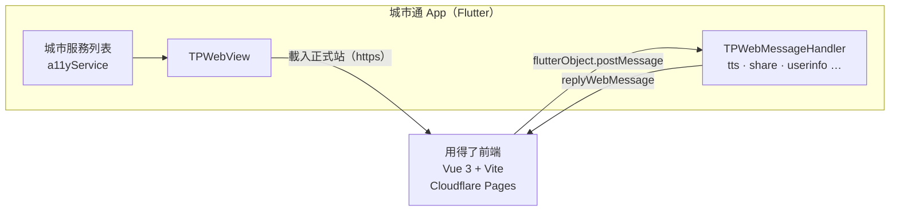

# 用得了

城市通（Town Pass）裡的無障礙申辦與溝通入口，2026 臺北秋季程式設計節作品，回應競賽主題「用不了」。

- 正式站：待補（Cloudflare Pages 網址）
- 授權：[AGPL-3.0](LICENSE)

「用得了」針對三種常見的卡關情境設計：表單看不懂、電話打不了、到了櫃檯對方不知道怎麼溝通。使用者在城市通裡設定一次自己的需求，之後申辦可以放大、可以朗讀；到櫃檯時出示溝通卡，承辦人用手機掃描就知道該怎麼溝通。

## 功能

- **我的需求**：設定字級、朗讀與溝通方式，城市通內共用。資料只存在使用者手機，不會上傳；溝通方式只描述「怎麼跟我溝通」，不標記障別。
- **我的溝通卡**：把溝通方式做成卡片與 QR code。櫃檯用自己的手機掃描就會看到同一張卡，也可以分享給家人或承辦人。
- **輔具補助申辦**：一頁一件事，每一步都能朗讀；自動帶入已設定的資料，拍照附上證明文件，送出前再確認一次。
- **字級與朗讀**：全站提供三段字級。在 app 內由 Flutter 端的 TTS 朗讀（Android WebView 不支援 `speechSynthesis`），在瀏覽器裡改用 Web Speech API。
- **系統字級同步**：app 會把 Android 系統字級帶進 WebView，使用者放大系統字級時，網頁也跟著放大。
- **技術與資料來源頁**（`/about`）：說明掛載方式、WebView 的限制與對策、無障礙自檢結果、資料來源與授權。

## 架構



- 前端是獨立的 SPA，部署在 Cloudflare Pages，由城市通的 `TPWebView` 載入；同一個網址也可以直接用瀏覽器開。
- 需要原生能力（朗讀、分享、使用者資料）時，前端透過 `frontend/src/lib/bridge.ts` 呼叫 Flutter 端的 handler；不在 app 內時，自動退回瀏覽器的實作。

## 技術棧

| 層 | 技術 |
| --- | --- |
| App | Flutter 3.47.6（FVM）、GetX、flutter_inappwebview、flutter_tts、share_plus |
| 前端 | Vue 3、Vite、TypeScript、Pinia、vue-router |
| 品質 | ESLint、Prettier、Vitest、`dart format`、`flutter analyze`，由 GitHub Actions CI 把關 |
| 部署 | Cloudflare Pages（前端）、Android APK（app） |

## 快速開始

```sh
# 前端（只要瀏覽器就能開發）
cd frontend
mise install && pnpm install
pnpm dev

# App（以 Android 為準）
fvm install
fvm flutter pub get
fvm dart run build_runner build
fvm flutter run -d <device-id>
```

完整指令、開發規範與協作流程見 [AGENTS.md](AGENTS.md) 與 [CONTRIBUTING.md](CONTRIBUTING.md)。

## 資料來源

| 資料 | 提供單位 | 連結 | 用途 |
| --- | --- | --- | --- |
| 待補 | 待補 | 待補 | 待補 |

開放資料依《政府資料開放授權條款－第1版》顯名，完整清單同步列在前端的 `/about`。

## 授權與致謝

- 本作品以 [AGPL-3.0](LICENSE) 授權。
- 本 repo 以臺北市政府開源的 [Town Pass](https://github.com/taipei-doit/TownPass)（GPL-3.0）快照為基礎開發；Town Pass 的設計與開發文件見 <https://tpe-guideline.web.app>。
