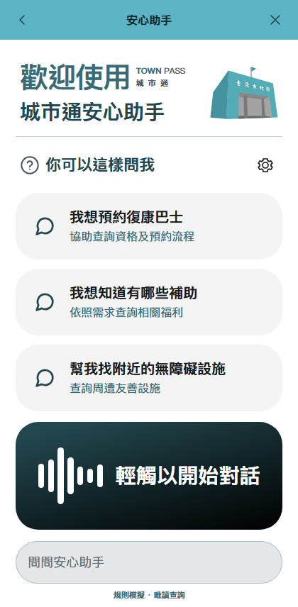
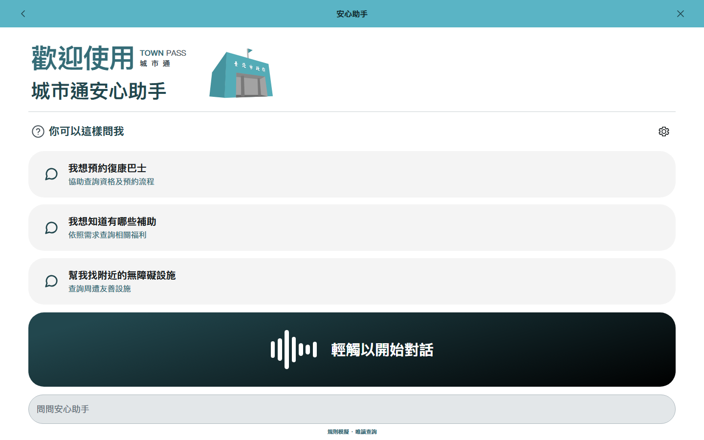
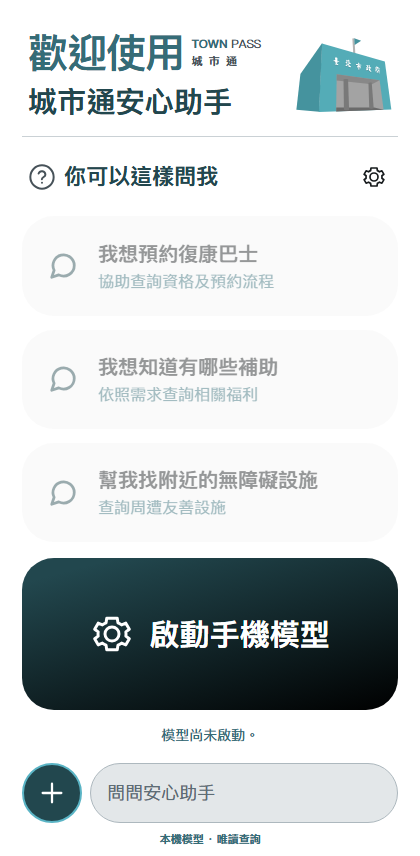
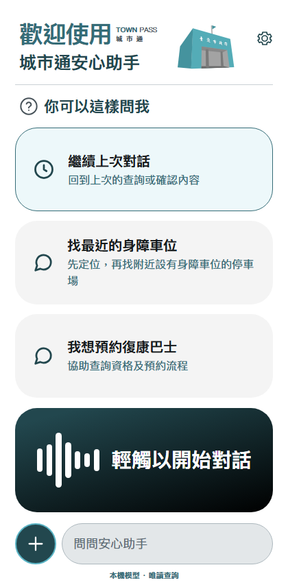
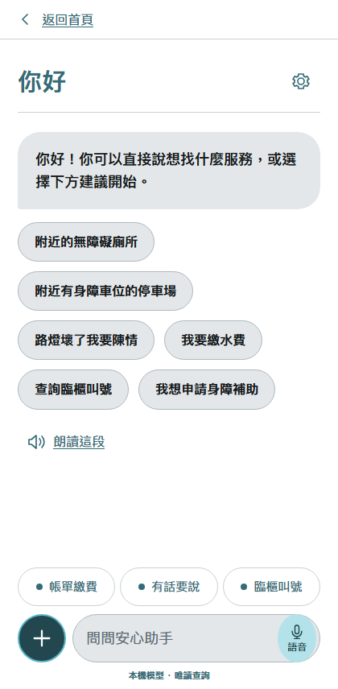

# 安心助手介面

## 設計基準

[Figma：安心助手畫面](https://www.figma.com/design/eg7CaqCSXBtZaRtxWgddYv/?node-id=2004-1347)







新版 App 模式的網頁畫面（瀏覽器 bridge 替身，非 Android 實機截圖）：




- 採用設計稿的青色頂欄、標誌組合、淺灰建議卡、訊息泡泡、深色語音區與圓角輸入列。
- 頁面填滿視窗；首頁固定一屏，聊天內容及設定可在各自的區域捲動。
- 標誌組合維持同列並等比例縮放。手機模型啟動後保留語音輸入按鈕，聊天輸入列也有語音入口。App 內的聊天頁提供「返回首頁」，不依賴 WebView 歷史或手機的系統返回鍵。
- 首頁建議依實際高度逐張增減，不分頁。空間極小時可以直接輸入需求。
- 底部「＋」和輸入列等高，僅接受 JPEG、PNG、WebP 照片。支援影像的模型啟動後，所選照片進入「有話要說」確認卡產生可編輯描述；仍須由使用者檢查並按「前往」，不會自動提交通報。模型未就緒時顯示啟動提示，不打開無效的檔案選擇器；PDF、文字檔不提供上傳入口。
- 首頁有舊進度時，「繼續上次對話」取代第一張「你可以這樣問我」建議卡，不另加按鈕區。只有明確點選這張卡才沿用舊進度；首頁直接打字、語音、選照片或點其他建議一律開始新對話。不另設「開新對話」按鈕。閱讀及模型設定不因新對話清除。
- 原位的顏色、透明度及展開／收合過渡提供操作回饋；互動元件不使用位移或浮起效果。系統設定減少動態效果時停用過渡。

## 功能邊界

查詢、帳單、官方服務導頁、離開前確認、草稿與回執沿用現有 Runner 及工具契約。獨立瀏覽器使用支援的語音辨識 API；App 內使用 Android 系統語音辨識，透過 `speech_start`／`speech_stop`／`speech_cancel` 操作，不需啟動本機 ASR 模型。辨識文字先填入輸入框，由使用者修改並明確送出。拒絕授權、辨識服務不可用或逾時時顯示訊息與文字輸入替代；仍需 Android 實機驗證收音、辨識與 TalkBack。

續開頁面時可恢復預設需求的識別碼、狀態摘要，以及已遮蔽身分證字號、電子郵件與六位以上數字序列的自由輸入文字；自由輸入最多保留 200 字。工具回覆、帳單內容、附件和定位座標不會寫入對話儲存。示範預約仍透過經驗證的書籍／分館識別碼續填，清除進度會一併移除摘要。

「通報災情」交由既有 Agent 查詢官方 `townpass_disaster` 服務，再由使用者確認是否前往；不在產品畫面提供本地虛構通報流程。

為了讓文字符合對比要求，瀏覽器頂欄使用深色標題；App 內沿用既有原生頂欄。網頁不繪製假的手機狀態列或系統鍵盤。

## 驗證

在 `frontend/agent-mvp/` 執行：

```sh
mise exec -- pnpm lint
mise exec -- pnpm format:check
mise exec -- pnpm test
mise exec -- pnpm build
mise exec -- pnpm test:e2e
```

端到端測試涵蓋查詢、確認、續填、取消、帳單、官方服務導頁、手機模型介面替身，以及瀏覽器語音辨識與失敗回復。版面檢查包含繁中／英文、大字、直橫向與既有草稿。axe 自動檢查不能取代 Android 實機、TalkBack 與真實語音引擎的驗證。
