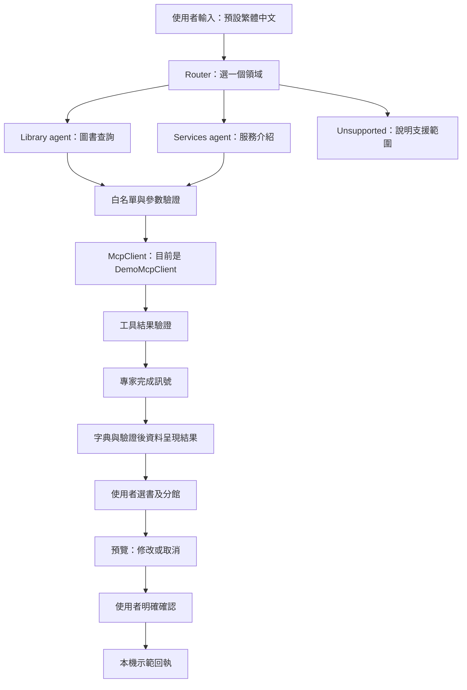
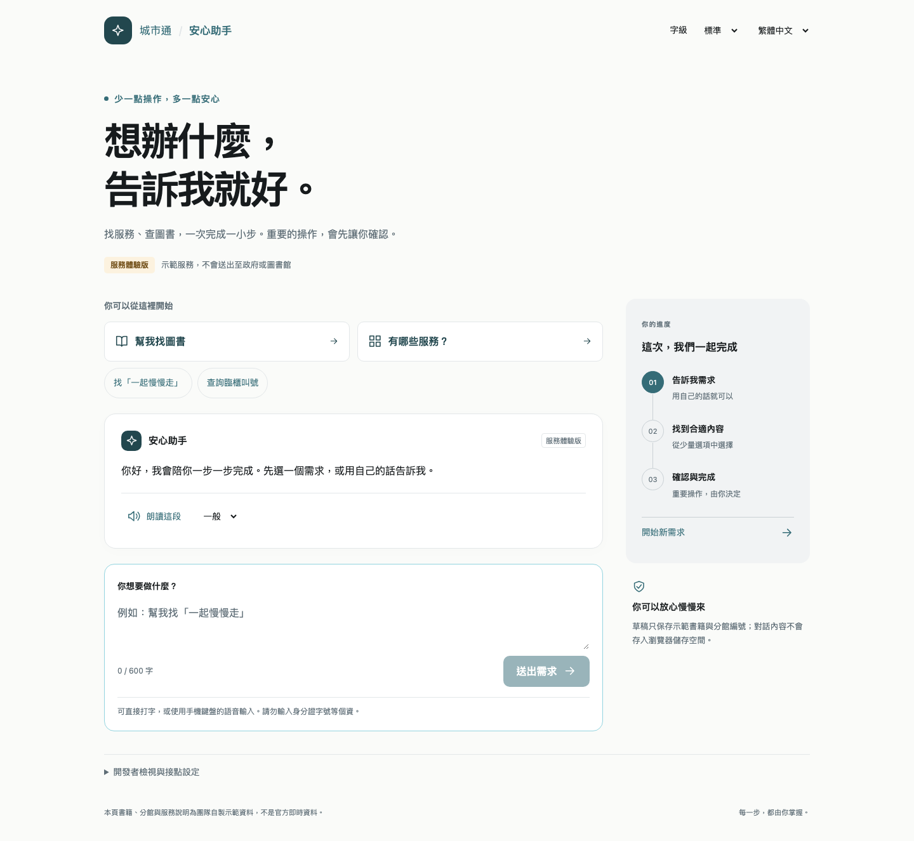
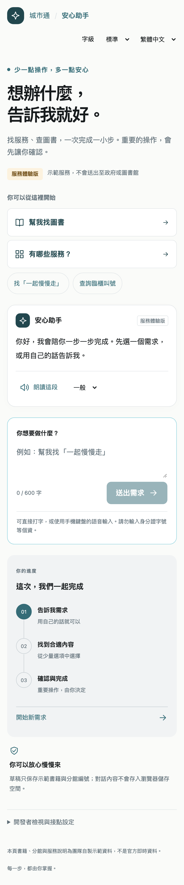

# UI／UX 交接：安心助手 MVP

## 現在的 Agent 流程



各代理共用一個小模型，依序執行不同英文提示；中文需求與專有名詞保留為資料。這是受限單次任務流程，尚無通用多輪規劃。預約確認不交給 LLM；沒有真實圖書館交易。當前實機驗證：Pixel 10 Pro XL 上的 Town Pass 開發版 WebView，推論透過 USB 在 Mac 執行。

## 分工

- **UI／UX 隊友**：資訊層級、版面、元件、文案、互動回饋、無障礙與可用性。
- **Agent 這邊**：分流、上下文、工具執行與驗證、狀態與確認、錯誤恢復、評測。
- **MCP／LLM 隊友**：正式本機推論介面、MCP transport、服務 API、登入授權。契約見 [README](../README.md) 與 [API 現況](api-status.md)。

## 不需要模型或 Flutter 即可開始

從 `feat/edge-agent-mvp` 建立自己的 UI 分支（MVP 合併後改從最新 frontend 建立）：

```sh
git fetch origin
git switch -c feat/agent-ui-ux origin/feat/edge-agent-mvp
cd frontend/agent-mvp
mise trust
mise install
mise exec -- pnpm install --frozen-lockfile
mise exec -- pnpm dev
```

開啟 <http://127.0.0.1:5173>。新 checkout 沒有 `.env.local`，預設使用規則模擬；不需要下載模型或 API key。如果原本有模型設定，從頁底「開發者檢視與接點設定」選「規則模擬」並套用。這個設定只供測試，不代表執行了 AI。

## 修改位置

| 檔案                                 | 內容                                                         |
| ------------------------------------ | ------------------------------------------------------------ |
| `src/App.vue`                        | 主要畫面、查詢／結果／確認／回執；可逐步拆分成元件           |
| `src/components/`                    | 可重用 Vue 元件，目前有 UiIcon                               |
| `src/style.css`                      | 版面、響應式、互動與焦點樣式                                 |
| `src/tokens.css`                     | 顏色與共用設計值，基於 Town Pass tokens                      |
| `src/i18n.ts`                        | 繁體中文與英文字典，文案集中管理                             |
| `src/platform/`                      | 草稿／偏好與朗讀；功能調整需與 agent 端一起確認              |
| `src/agent/`                         | Harness 與邊界契約；UI 調整不需改模型、工具名稱或回傳 schema |
| `tests/app.e2e.ts`                   | 使用者流程、axe、雙語 200% 字級檢查                          |
| `../../lib/util/tp_agent_entry.dart` | App 首頁與服務頁的共用入口                                   |

現有截圖為交接基準，可自由迭代設計：





## 優先改善的體驗

1. 讓使用者更快找到主要操作：目前首頁內容較長，手機上輸入框在較下方。
2. 清楚呈現目前步驟與下一步；查詢、選擇、確認應容易區分。
3. 改善錯誤／無結果／不支援需求的引導，避免只顯示技術性訊息。
4. 分開一般使用者與開發者資訊；保留清楚可辨識的「示範」標示。
5. 用 TalkBack、鍵盤與實際目標使用者驗證，記錄卡住的步驟。

## 需保留的互動契約

- 送出前有預覽與明確確認；修改分館會更新草稿 ID，不能沿用舊確認。
- 搜尋不會自行預約；取消、錯誤與無結果不能顯示成功回執。
- 忙碌時不能重複送出，可停止處理；有未確認草稿時先確認或取消。
- 不把示範回執寫成正式成功，不把規則模擬寫成 AI。
- 不在 component 內直接 fetch LLM／MCP，不擴大工具權限；呼叫現有 runner 與操作函式。
- 保留標籤、語意化按鈕、可見焦點、狀態通知、48dp 觸控目標，繁中與英文的 200% 字級不截斷或橫向溢出。
- UI 字串放字典檔；只保存必要偏好與示範進度，不保存對話或敏感個資。
- 最新 App 已提供 `tts`／`share` bridge；MVP Vue 尚未接上，不能只因瀏覽器朗讀成功就標示 App 也支援。無障礙支援須有文字替代。

## 提交驗收

```sh
mise exec -- pnpm lint
mise exec -- pnpm test
mise exec -- pnpm build
mise exec -- pnpm exec playwright install chromium
mise exec -- pnpm test:e2e
```

手動走一遍：瀏覽圖書 → 指定書名 → 查無結果 → 服務介紹 → 不支援需求 → 選書 → 修改分館 → 重開續填 → 取消／確認 → 清除進度。再檢查英語、最大字級、橫向、鍵盤及 TalkBack；改文案時同步更新測試的可存取名稱。

既有驗證：前端單元測試 13、E2E 3、Flutter widget tests 2；真實模型回歸情境 8。axe 與 200% 字級已通過；TalkBack、切換控制、完整橫向與目標使用者可用性測試仍待完成，不能宣稱全面符合 WCAG。

PR 附前後截圖、改動原因與上述自檢結果；至少一位 reviewer，維護者 squash merge。若 UX 需要多輪補問、真實服務或新的任務狀態，先與 agent／MCP 隊友對齊契約。
